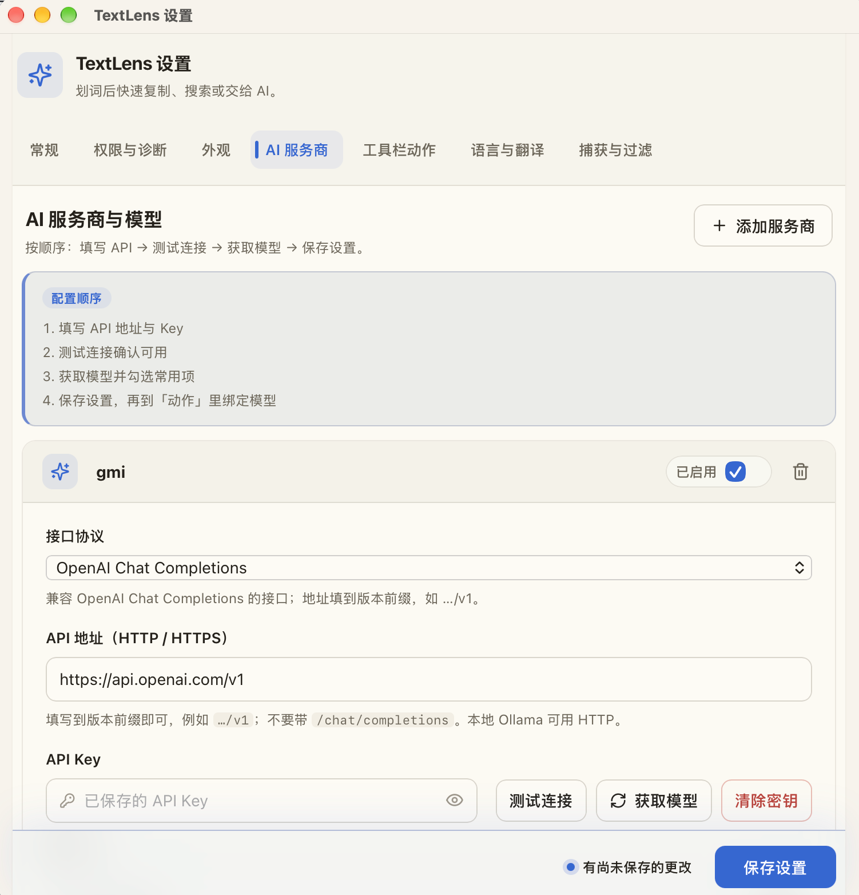
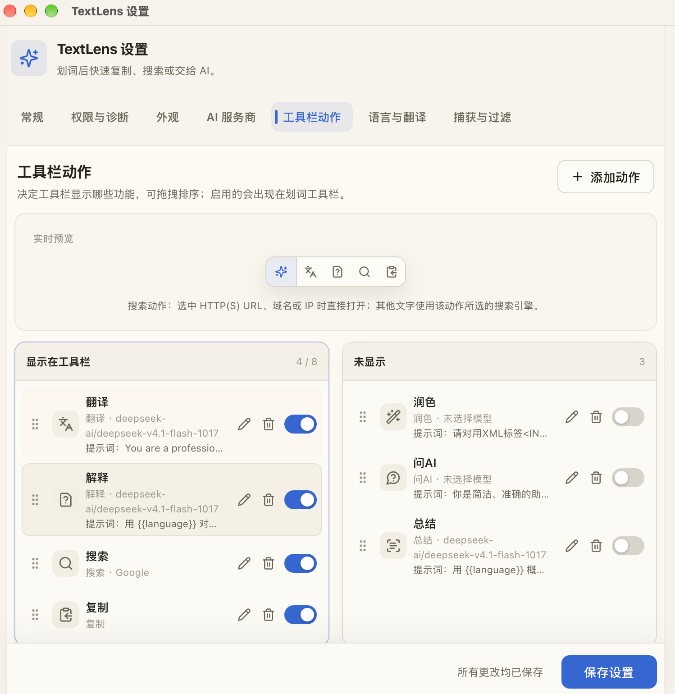
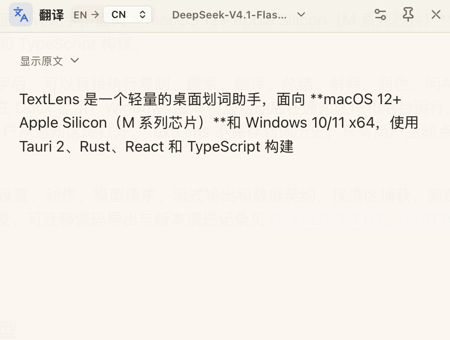

# TextLens

**English** | [中文](./README.md)

TextLens is a lightweight desktop selection assistant for **macOS 12+ Apple Silicon (M-series)** and **Windows 10/11 x64**, built with Tauri 2, Rust, React, and TypeScript.

After selecting text in another app, you can copy, search, translate, summarize, explain, polish, Ask AI, or run custom AI actions. On macOS it lives in the menu bar and stays out of the Dock by default. On Windows it runs in the background from the notification area after a brief “TextLens is running” toast; open Settings from the tray menu. TextLens does not store selection history. Selected text is sent to your configured model only when you explicitly run an AI action.

Both platforms share the same renderer, settings, actions, model requests, streaming, and data contracts. Only selection capture, clipboard handling, native window attributes, and system integration are platform-specific. Local development, portable source export, and version history are documented in [DEVELOPMENT_HANDBOOK.md](./DEVELOPMENT_HANDBOOK.md) (Chinese).

## Screenshots

### Settings · AI providers and models

### Settings · Toolbar actions

### Result window

## Design inspiration and third-party sources

- Product direction and some interaction patterns are inspired by the “selection assistant” workflow in [CherryHQ/cherry-studio](https://github.com/CherryHQ/cherry-studio), including the selection toolbar, result window, pin, dismiss-on-blur, re-select, and model switching.
- Cherry Studio is primarily Electron-based; TextLens uses the lighter Tauri stack to rebuild that workflow as a standalone desktop tool with its own window management, settings storage, model requests, and UI.
- The macOS selection-capture bridge is adapted from MIT-licensed [selection-hook 2.0.2](https://github.com/0xfullex/selection-hook/tree/v2.0.2). The full MIT license is in [LICENSE.selection-hook](./LICENSE.selection-hook).

TextLens does not declare its own open-source license. Materials adapted from Cherry Studio remain under upstream AGPL-3.0; selection-hook adaptations remain under MIT. Read the third-party notices before public distribution or derivative work.

## Features

Core selection-assistant workflow:

- Selection toolbar: copy, search, translate, summarize, explain, polish, Ask AI, and custom actions.
- Actions can be enabled/disabled, renamed, reordered, and re-iconed; icon-only mode is supported. Search can use Google / Bing / Baidu; URLs, domains, and IPs open directly when possible.
- Multiple OpenAI-compatible providers and models; providers can be enabled or disabled; each action can bind its own model and prompt; fetch models, multi-select merge, and reorder are supported.
- Streaming results with Markdown / tables / math; drag, resize, pin, and several dismiss modes; text in the result body can be selected again for a new toolbar.

Enhancements beyond a basic selection assistant:

- **Follow-up in results:** Translate / explain / summarize / polish result windows support multi-turn questions at the bottom (not only Ask AI).
- **Header model switch & regenerate:** Switch models by provider group and regenerate in the same window; translation targets include CN/EN/JA/KO/RU/DE/FR.
- **Multilingual translation:** Auto-detect source language; default other languages → Chinese, Chinese → English; primary/backup language pairs are configurable.
- **Ask AI sessions:** Open a result window with selection as context; you can wait before the first model call, then chat multi-turn. Retrying a failed turn retains its question and earlier conversation, and both display and copy include the full transcript. Sessions stay within the current result window.
- **Thinking & streaming:** Streaming thinking / reasoning display; thinking levels inferred from model names (including “off”); low-latency streaming.
- **Provider enable/disable:** Disabled providers are hidden from action binding and result model lists. Already-bound actions also refuse to run and prompt you to update their configuration.
- **Popup and waiting feedback:** The toolbar and result window use a brief fade-in, and three dots bounce in sequence while waiting for the model. Long action names truncate or scroll horizontally while retaining full tooltips. The system’s reduced-motion preference disables waiting animations and stream typewriter playback.
- **Plays well with other apps:** When the clipboard holds something TextLens cannot fully preserve (a screenshot, for example), the temporary copy is skipped instead of rewriting your clipboard. On macOS, the source highlight is cleared after a short delay once copy/search succeeds or the result window is shown; configuration rejection or a failed result reveal leaves it selected. Windows currently leaves source highlights unchanged. A leftover selection no longer brings the toolbar back on an unrelated click.
- **Settings and keyboard accessibility:** Edits and new API keys entered while a save is pending remain as unsaved drafts. Dialogs trap and restore focus, and validation switches to the relevant section and field. Toolbar focus rings, model listbox navigation, arrow-key radio groups, and keyboard drag-reordering are supported; Settings has seven sections.
- **Lightweight & private:** Standalone Tauri tool; API keys encrypted locally; no selection history; text is sent only when you click an AI action.

## Tech stack

| Layer | Technology | Role |
| --- | --- | --- |
| Desktop framework | Tauri 2 | App lifecycle, menu bar / tray, WebView windows, IPC, permissions, packaging |
| Native backend | Rust 2021 | Selection control, window placement, settings, encryption, clipboard, streaming model requests |
| macOS bridge | Objective-C++, Accessibility API, Core Graphics, AppKit | Global selection, clipboard-compat capture, window level |
| Windows backend | Rust, UI Automation, Win32, OLE, low-level input hooks | Isolated capture, clipboard restore, hook recovery, non-activating windows, mixed DPI, single instance |
| Frontend | React 19, TypeScript 5.9 | Settings, toolbar, result window |
| Build | Vite 7, pnpm 11, Cargo | Web build, lockfiles, Rust compile |
| Validation | Zod, Serde, serde_json | Cross-boundary schemas and runtime checks |
| UI | Lucide React, dnd kit | Action icons, custom icons, drag reorder |
| Markdown | react-markdown, remark-gfm, remark-math, rehype-katex, KaTeX | Safe Markdown, tables, lists, math |
| Network & streaming | reqwest, Tokio, futures-util | OpenAI-compatible HTTP, SSE, cancel, stream buffering |
| Local security | ring, base64, atomic file writes | AES-256-GCM API key storage |
| Concurrency | parking_lot, tokio-util, UUID | Window state, request sessions, cancellation |
| Testing | Vitest, Testing Library, jsdom, Rust tests | Frontend and backend logic tests |
| Release | Tauri CLI, DMG, NSIS | macOS arm64 app and Windows x64 installer |

macOS uses system WKWebView; Windows uses Microsoft Edge WebView2 Runtime. The macOS app uses local ad-hoc signing only, with no Developer ID signing or notarization; Windows NSIS outputs are unsigned test builds.

## Major open-source dependencies

Projects that directly shape TextLens features. Exact versions come from [pnpm-lock.yaml](./pnpm-lock.yaml) and [src-tauri/Cargo.lock](./src-tauri/Cargo.lock). Attribution details are in [THIRD_PARTY_NOTICES.md](./THIRD_PARTY_NOTICES.md).

| Project | Role | License |
| --- | --- | --- |
| [Cherry Studio](https://github.com/CherryHQ/cherry-studio) | Interaction reference; some default AI prompts adapted | AGPL-3.0 |
| [selection-hook 2.0.2](https://github.com/0xfullex/selection-hook/tree/v2.0.2) | Upstream base for the macOS selection bridge | MIT |
| [Tauri](https://github.com/tauri-apps/tauri) | Cross-platform desktop framework, windows, packaging | Apache-2.0 OR MIT |
| [React](https://github.com/facebook/react) | UI | MIT |
| [dnd kit](https://github.com/clauderic/dnd-kit) | Settings action drag reorder | MIT |
| [Lucide](https://github.com/lucide-icons/lucide) | Toolbar and settings icons | ISC |
| [react-markdown](https://github.com/remarkjs/react-markdown) | Safe Markdown rendering | MIT |
| [remark-gfm](https://github.com/remarkjs/remark-gfm) | GFM tables, task lists, etc. | MIT |
| [remark-math](https://github.com/remarkjs/remark-math) | Math syntax in Markdown | MIT |
| [rehype-katex](https://github.com/remarkjs/remark-math/tree/main/packages/rehype-katex) / [KaTeX](https://github.com/KaTeX/KaTeX) | Math rendering | MIT |
| [Zod](https://github.com/colinhacks/zod) | Frontend validation | MIT |
| [reqwest](https://github.com/seanmonstar/reqwest) | OpenAI-compatible HTTP and SSE | MIT OR Apache-2.0 |
| [Tokio](https://github.com/tokio-rs/tokio) | Rust async runtime | MIT |
| [Serde](https://github.com/serde-rs/serde) | Rust (de)serialization | MIT OR Apache-2.0 |
| [ring](https://github.com/briansmith/ring) | Key derivation and AES-256-GCM | ISC, MIT, OpenSSL |
| [objc2](https://github.com/madsmtm/objc2) | Rust ↔ macOS AppKit/Foundation | MIT |
| [macos-accessibility-client](https://codeberg.org/fresskoma/macos-accessibility-client) | macOS accessibility permission checks | Apache-2.0 |
| [windows-rs](https://github.com/microsoft/windows-rs) | Windows UIA, window, input, clipboard, OLE | MIT OR Apache-2.0 |
| [Vite](https://github.com/vitejs/vite) / [Vitest](https://github.com/vitest-dev/vitest) | Frontend build and tests | MIT |
| [TypeScript](https://github.com/microsoft/TypeScript) | Type system and compiler | Apache-2.0 |

These projects also pull transitive dependencies. Before a formal public release, generate a full inventory from both lockfiles and review licenses and copyright notices.

## Architecture and data flow

1. Platform selection backends listen for global mouse, keyboard, and scroll events; macOS uses Accessibility/Event Tap, Windows uses UI Automation/low-level input hooks. Windows assigns a token per Hook instance and only installs a new instance when the previous one exits abnormally or is confirmed replaced—no periodic blind reinstall.
2. On Windows, UIA/OLE capture that may block on third-party providers runs in a separate helper process started from the same executable; timeouts, crashes, or protocol errors isolate and rebuild the helper without saturating the main capture thread.
3. When standard APIs cannot read allowed custom-drawn apps, the backend briefly uses copy; original clipboard content is restored only if it was not modified again. If the current clipboard cannot be snapshotted completely (a screenshot, for example), the temporary copy is skipped and the clipboard is left alone.
4. The Rust runtime validates the selection and positions the toolbar.
5. On action click, local actions run on device; AI actions create a request session and send text.
6. reqwest receives SSE or JSON model responses and forwards content deltas immediately. Empty answers, truncated responses, and read timeouts report a failure while retaining any text already received.
7. The result window renders safe Markdown while streaming and loads math support when needed. Logical text updates immediately; adaptive playback smooths the display and completion reveals the full text. Reduced motion shows complete deltas directly.
8. Settings and provider metadata live in local JSON; API keys are encrypted on disk. Normal settings payloads only expose `keyConfigured`. The settings window can reveal or edit plaintext via settings-only IPC when the user clicks show; toolbar and result windows cannot read keys.

Main directories:

- `apps`: platform entrypoints (“shared core + thin platform layer”); see [apps/README.md](./apps/README.md).
- `apps/macos`: macOS selection bridge, icons, artifact verification.
- `apps/windows`: Windows selection, startup toast renderer, icons, artifact verification.
- `src-tauri/src`: lifecycle, windows, tray, permissions, settings, local encryption, selection, model requests.
- `src/shared`: data contracts, defaults, actions, prompts, URL/IP detection.
- `src/renderer/toolbar`: selection toolbar.
- `src/renderer/result`: AI result window, streaming, Markdown.
- `src/renderer/settings`: providers, models, actions, window behavior.
- `src/renderer/startup`: Windows startup toast build entry shim; implementation lives under `apps/windows/renderer/startup`.
- `assets` and `src-tauri/icons`: shared assets and remaining generic/mobile icons.

## Privacy and security

- Text is sent only when you run an AI action or submit a follow-up. Chat and selection history are not persisted; the temporary conversation stays within the current result window.
- AI text defaults to a 20,000 character limit with an explicit error—no silent truncation.
- Normal settings (`get_settings` / `PublicSettings`) include only `keyConfigured`, not plaintext API keys; on-disk settings JSON also stores no plaintext keys.
- The settings window can load a saved API key via settings-only IPC (`get_provider_api_key`) when the user **clicks show**; toolbar and result windows cannot call that command.
- API keys are AES-256-GCM encrypted locally; macOS Keychain and Windows Credential Manager are not used.
- Webviews use Tauri’s isolation model, a strict CSP, and minimal capabilities.
- Markdown does not enable raw HTML; scripts, event handlers, dangerous protocols, and remote images are not executed.
- External links allow HTTP and HTTPS only; logs must not record API keys or selected text. Selection tracing is opt-in via `TEXTLENS_SELECTION_TRACE` and records selection length plus a hash by default; a masked prefix appears only with `TEXTLENS_TRACE_CONTENT`.
- OpenAI-compatible base URLs may be HTTP or HTTPS. HTTP sends keys and content in the clear—use only on localhost or trusted LAN; prefer HTTPS elsewhere.
- Base URLs need a version prefix such as `https://api.openai.com/v1`, without `/chat/completions`. Connection tests hit `{baseUrl}/models`; actions hit `{baseUrl}/chat/completions`.

## Install - Windows

Windows builds target Windows 10/11 x64 with standard-user, current-user NSIS install (no admin required).

1. Run the NSIS installer; if WebView2 Runtime is missing, the bootstrapper is launched automatically.
2. Unsigned test builds may trigger Microsoft Defender SmartScreen; after verifying SHA-256 you can choose “More info → Run anyway”.
3. On first launch the app stays in the notification area and does not open Settings automatically; use the tray menu.
4. Closing Settings with X hides to the tray by default; this can be changed to quit. Full quit is available from the tray menu (“Quit TextLens”).
5. TextLens does not elevate, so it cannot read selections from admin-elevated apps; normal-privilege apps are fine.

The Windows installer is still an unsigned test build and may trigger SmartScreen. Automated checks do not replace real-world app, privilege, and DPI testing. Not suitable for public distribution before code signing and full compatibility acceptance.

## Install - macOS

Only Apple Silicon builds are published; they do not run on Intel Macs.

1. Open the DMG and drag TextLens to Applications.
2. Fully quit any running older TextLens from the menu bar before installing a new version; the new build is a menu-bar tool and does not appear in the Dock by default.
3. If Gatekeeper blocks first launch, right-click TextLens in Finder and choose Open, or allow it under System Settings → Privacy & Security.
4. Enable TextLens under System Settings → Privacy & Security → Accessibility, then restart the app.

The macOS app uses local ad-hoc signing only and has no Developer ID signing or notarization. It remains a test build; those steps are still required before a formal public release.

## Third-party licenses and release checklist

When distributing source or binaries, retain at least:

- [THIRD_PARTY_NOTICES.md](./THIRD_PARTY_NOTICES.md)
- [LICENSE.selection-hook](./LICENSE.selection-hook)
- Copyright and license texts required by upstream projects

TextLens currently declares no open-source license and has no Apple Developer ID, Windows Authenticode signing, notarization, or auto-update. Before a formal public release, complete full dependency license inventory, security review, signing, notarization, and install acceptance.

## Friend Links

- [LINUX DO](https://linux.do) - 学AI，上L站！
